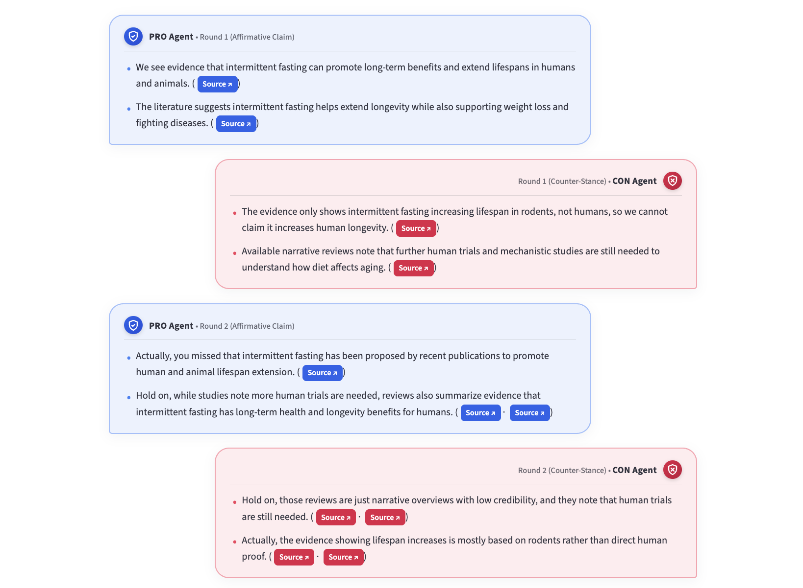
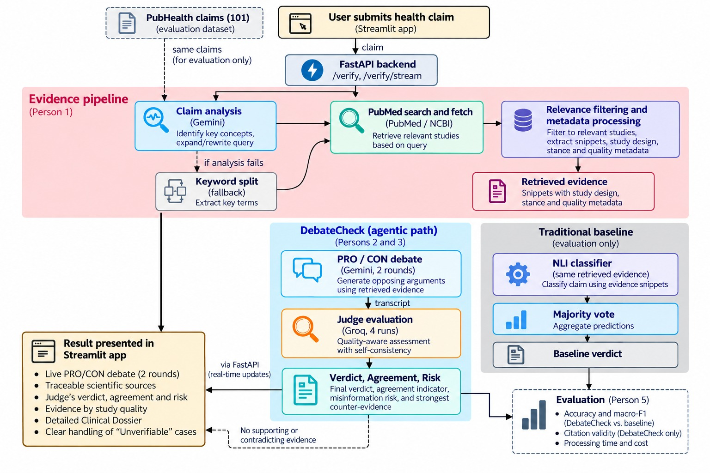

# DebateCheck

Evidence-grounded health claim verification. Two AI agents (PRO and CON) debate a claim using studies
retrieved from PubMed, and a judge weighs the arguments by study quality. The judge returns a verdict, an
agreement-based confidence score, a misinformation risk level, and the strongest counter-evidence.

**Live demo:** https://debatecheck.onrender.com/ (free tier: allow about a minute to wake up)
**poster:** see [`docs/`](docs/)



> ⚠️ DebateCheck is an educational evidence-exploration tool. It does not give medical advice.

Course project: 36118 Applied Natural Language Processing, UTS, Spring 2026 (AT2).
Team: Parisasadat Kalaki, Agam Singh Saini, Chenchira Bamrung, Ezgi Kemer Alp, Seyoung Kim.

## How it works



Border colour shows the external service (blue: Gemini, green: PubMed, amber: Groq). Dashed arrows show
fallbacks and evaluation. If no snippet supports or contradicts the claim, the debate and judge are skipped,
the verdict is "Unverifiable", and a one-line general-knowledge quick answer is shown, clearly labelled.

## Quick start

### 1. Prerequisites

- **Git** ([git-scm.com](https://git-scm.com/downloads))
- **Python 3.10 or newer** (tested on 3.12) ([python.org](https://www.python.org/downloads/))
- **uv**, installed in step 3

### 2. Free API keys

| Key              | Used for                                           | Get it                                                               |
| ---------------- | -------------------------------------------------- | -------------------------------------------------------------------- |
| `NCBI_EMAIL`     | Your email. PubMed requires it.                    | Use your own                                                         |
| `NCBI_API_KEY`   | Optional. Raises the PubMed rate limit.            | [ncbi.nlm.nih.gov](https://www.ncbi.nlm.nih.gov/) → Account Settings |
| `GOOGLE_API_KEY` | Gemini: claim analysis, stance, debate, conclusion | [aistudio.google.com/apikey](https://aistudio.google.com/apikey)     |
| `GROQ_API_KEY`   | Groq: the judge                                    | [console.groq.com/keys](https://console.groq.com/keys)               |

Never share your keys or commit your `.env` file (it is in `.gitignore`).

### 3. Install

**macOS**

```bash
git clone https://github.com/ParisaKalaki/debatecheck.git
cd debatecheck
curl -LsSf https://astral.sh/uv/install.sh | sh     # restart Terminal afterwards
uv venv
source .venv/bin/activate
uv pip install -r backend/requirements.txt
```

**Windows (PowerShell)**

```powershell
git clone https://github.com/ParisaKalaki/debatecheck.git
cd debatecheck
powershell -ExecutionPolicy ByPass -c "irm https://astral.sh/uv/install.ps1 | iex"   # restart PowerShell
uv venv
.venv\Scripts\activate
uv pip install -r backend/requirements.txt
```

If Windows blocks activation, run `Set-ExecutionPolicy -Scope CurrentUser RemoteSigned` once.

### 4. Add your keys

The easiest way is to start the app (step 5). It shows a one-time setup form for missing keys, checks each
key, and can save them to `.env`. Or edit `.env` yourself:

```bash
cp .env.example .env        # Windows: copy .env.example .env
```

```dotenv
NCBI_EMAIL=you@example.com
NCBI_API_KEY=
GOOGLE_API_KEY=your-gemini-key
GROQ_API_KEY=your-groq-key
```

### 5. Start the app (two terminals)

Open two terminals in the `debatecheck` folder and activate the virtual environment in each.

**Terminal 1: backend**

```bash
cd backend
uvicorn app.api.main:app --reload --port 8002
```

Wait for `Application startup complete` (check <http://127.0.0.1:8002/health>).

**Terminal 2: frontend** (from the `debatecheck` root, not `backend/`)

```bash
streamlit run frontend/app.py
```

The app opens at <http://localhost:8501>. Press `Ctrl + C` in both terminals to stop.

### 6. Demo mode (no keys, no API calls)

Add `DEBATECHECK_USE_FIXTURE=true` to `.env` and restart the backend. Every claim then returns the saved
vitamin D example instantly. Set it back to `false` for real results.

## Using the app

Enter a specific health claim (for example, _"Vitamin D supplements prevent respiratory infections"_) and
click **Check claim**. A run usually takes 1 to 3 minutes. The page shows:

- **Live Evidence Debate:** PRO and CON arguments as a chat over two rounds. Every point links to its PubMed source.
- **Judge's verdict, misinformation risk, evidence by study quality:** summary cards. The ring shows
  _agreement_ across four judge runs. It is not the probability that the claim is true.
- **Strongest evidence against the verdict**, and a **plain-language conclusion**.
- **Detailed dossier (collapsed):** the judge's reasoning, limitations, and every retrieved snippet, filterable by stance.

Name the intervention and the outcome. Niche topics may have little PubMed evidence and return
"Unverifiable", which is an honest result, not an error.

## Results (101 PubHealth claims)

|                                         | NLI baseline | DebateCheck |
| --------------------------------------- | -----------: | ----------: |
| Accuracy, all claims                    |        7.92% |       9.90% |
| Macro-F1, all claims                    |        7.31% |      10.86% |
| Accuracy, claims with evidence (n = 17) |       35.29% |      47.06% |
| Macro-F1, claims with evidence          |       23.08% |      35.54% |

Usable PubMed evidence was retrieved for only 17 of 101 claims (16.8%), which is the main bottleneck, and
the remaining claims defaulted to "unproven". All 181 citation IDs produced by the agents were valid, and
the mean time per evidence-bearing claim was about 21 seconds. The difference rests on a small subset, so
treat it as preliminary. The full methodology and discussion are in the report (`docs/`), and the scripts
and result files are in `evaluation/`.

## Repository structure

```text
backend/app/retrieval/   claim analysis, PubMed search, filtering, snippets, stance
backend/app/baseline/    traditional NLI baseline
backend/app/agents/      PRO/CON debate (LangGraph), quick answer, debate conclusion
backend/app/judge/       quality-aware judge with self-consistency
backend/app/api/         FastAPI routes (verify, streaming, key setup)
backend/app/core/        shared schemas, lazy API clients, key settings
backend/tests/           saved fixtures from real pipeline runs
frontend/                Streamlit app
evaluation/              benchmark scripts and results
docs/                    report, poster, screenshots
```

### Run a single component

All code uses package imports, so run from `backend/` with `python -m`:

```bash
cd backend
python -m app.retrieval.evidence_pipeline     # evidence retrieval
python -m app.baseline.nli_classifier         # traditional baseline
python -m app.agents.debate_graph             # debate (uses saved fixture)
python -m app.judge.judge_agent               # judge (uses saved fixture)
```

Running a file directly (`python evidence_pipeline.py`) will fail with import errors.

### Optional settings (in `.env`)

| Variable                                                             | Default                 | Purpose                      |
| -------------------------------------------------------------------- | ----------------------- | ---------------------------- |
| `DEBATECHECK_USE_FIXTURE`                                            | `false`                 | Demo mode with saved results |
| `DEBATE_MODEL`, `ANALYZER_MODEL`, `EXPLAINER_MODEL`, `SUMMARY_MODEL` | `gemini-3.5-flash-lite` | Gemini models                |
| `JUDGE_MODEL`                                                        | `openai/gpt-oss-120b`   | Judge model (Groq)           |

`DEBATECHECK_API_URL` (default `http://127.0.0.1:8002`) tells the frontend where the backend is. Set it in
the terminal, not in `.env`.

## Troubleshooting

| Problem                                                | Fix                                                                                                                                    |
| ------------------------------------------------------ | -------------------------------------------------------------------------------------------------------------------------------------- |
| `ModuleNotFoundError`                                  | The virtual environment isn't active, or packages are out of date. Activate it and rerun `uv pip install -r backend/requirements.txt`. |
| `uv`, `streamlit` or `uvicorn` not found               | Restart the terminal and activate the virtual environment.                                                                             |
| "Can't reach the DebateCheck backend"                  | Terminal 1 isn't running or crashed. Start it and refresh the page.                                                                    |
| "An API key is missing" or "Could not verify this key" | Open **API keys** in the sidebar. The message after the dash is the provider's real error.                                             |
| "Backend returned 500"                                 | Check the error in Terminal 1.                                                                                                         |
| Very slow run, or `rate limited by Groq`               | Expected on Groq's free tier. The judge waits and retries automatically.                                                               |
| Port 8002 already in use                               | Start the backend on another port, then set `DEBATECHECK_API_URL` to match in the frontend's terminal.                                 |

## Known limitations

- Evidence is limited to PubMed abstracts of up to 8 papers per claim, so relevant studies can be missed.
  The relevance filter is lexical, so a paper that uses different vocabulary can be dropped.
- A valid citation is not necessarily a faithful one. Every point cites a real snippet, but an agent can still
  overstate it. This was not measured automatically.
- The `humanize_text()` function in the frontend rewrites some agent wording for readability, which can
  slightly change nuance.
- "Unverifiable" results with no debate carry placeholder confidence and risk values and should be excluded
  from judge-calibration analysis.
- Groq's free tier is rate-limited, which can add waits of up to several minutes.
